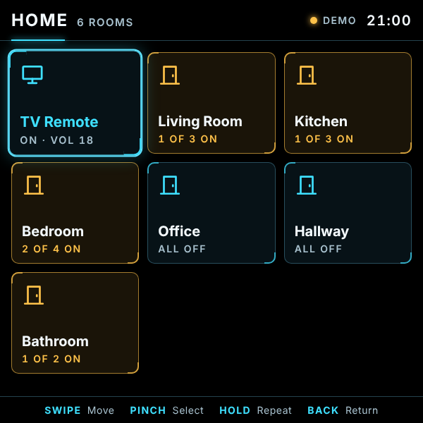
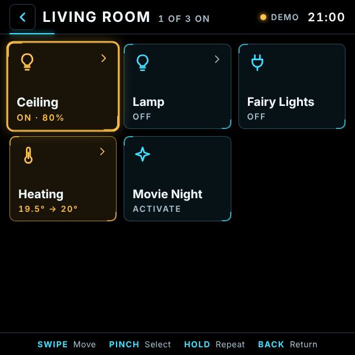
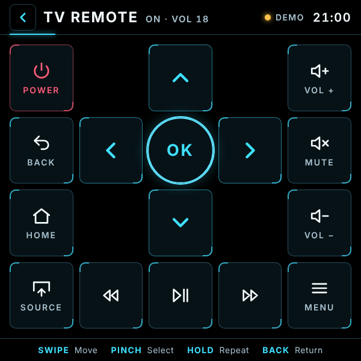

[README (1).md](https://github.com/user-attachments/files/34152018/README.1.md)
# Home Deck

A Home Assistant dashboard built for **Meta Ray-Ban Display** glasses: a 600×600, dark, high-contrast HUD that you drive with the Neural Band (swipe to move, pinch to select).

- **Rooms** load automatically from your Home Assistant areas
- **Lights, switches, fans, scenes and scripts** with a single pinch
- **Brightness and thermostat** control: swipe left/right to adjust
- **Samsung TV remote**: power, volume, mute, D-pad, home, back, source and playback, with hold-to-repeat
- **Your token stays secret.** A small server function (`api/home.js`) talks to Home Assistant, so your token never reaches the browser

| Home | Room | Adjust | TV remote |
|---|---|---|---|
|  |  |  |  |

> Black is see-through on the Display's additive screen, so the UI is drawn with light (outlines and glow) rather than solid panels.

---

## Setup

Home Deck is part of the Deck hub: setup, environment variables and the glasses address are in the [main README](../README.md). It needs:

- **Home Assistant** reachable from the internet over HTTPS. [Nabu Casa](https://www.nabucasa.com/) is the easiest way; any other secure external URL works too.
- A **long-lived access token** from Home Assistant (Profile → Security → Long-lived access tokens). Ideally create a separate Home Assistant user just for this app.
- `NABU_CASA_URL`, `HA_TOKEN` and `APP_CODE` set in Vercel. **`APP_CODE` is required for Home**: without it, `/api/home` refuses to run, because it can switch things on and off.
- *Optional:* the **Samsung Smart TV** integration in Home Assistant for the TV remote (see [TV remote](#samsung-tv-remote)).

Glasses address: `https://YOUR-PROJECT.vercel.app/home/` (with the slash at the end).

## Using it

| Gesture | Action |
|---|---|
| Swipe | Move between tiles |
| Pinch | Open a room / toggle a device / press a remote button |
| Hold | Repeat (volume, D-pad, seek) |
| Back | Return to the previous screen |

- Tiles with a **›** open an adjust screen (dimmable lights, thermostats). Swipe left or right to change the value, then pinch to confirm.
- **Amber** means on; **cyan** marks your current focus.

**Demo mode:** add `?demo` to the address (or pinch **Try demo** on the lock screen) to try the app with sample data and no Home Assistant.

## Configuration

Settings are in the `CONFIG` block at the top of `home/app.js`:

| Setting | Default | What it does |
|---|---|---|
| `tvMediaPlayer` / `tvRemote` | `null` (auto-detect) | Set these to your TV's entity IDs if it isn't found automatically, e.g. `'media_player.samsung_tv'` |
| `domains` | lights, switches, fans, climate, cameras, scenes, scripts | Which kinds of device to show |
| `dimmableOpensDetail` | `true` | `false` makes a pinch on a dimmable light just toggle it |
| `brightnessStep` | `5` | Brightness change (%) per swipe |
| `pollMs` | `5000` | How often device states refresh (ms) |
| `cameraRefreshMs` | `1000` | How often the camera picture refreshes (ms) |
| `ptzSpeed` / `ptzDuration` | `0.6` / `0.4` | How fast, and for how long (seconds), each swipe moves the camera |
| `cameraControls` | `{}` | Extra buttons for a camera, e.g. `{ 'camera.front_door': ['switch.front_door_privacy'] }` |
| `cameraPtz` | `{}` | Which entity moves a camera, if it's a different one, e.g. `{ 'camera.front_door': 'camera.front_door_mainstream' }` |
| `pollMs` | `5000` | How often device states refresh (ms) |
| `keys` | arrow keys, Enter, Escape… | Map these to different keys if your input arrives differently |

Gesture keys (arrow keys, Enter, Escape…) are shared by every app: change them in `KEYS` in `deck/deck.js`.

**Rooms** come from Home Assistant **areas**: assign your devices to areas in Home Assistant. If your token can't read areas (this may need an admin user), the app groups devices by type instead.

## Samsung TV remote

- The **D-pad, Home, Back, Source and Menu** buttons send key commands. These need the `remote.*` entity from Home Assistant's **Samsung Smart TV** integration.
- **Power and volume** work through the TV's `media_player` entity, including when it comes from SmartThings.
- **Turning the TV on from fully off** usually needs Wake-on-LAN set up in the Samsung integration.

## Cameras

Any `camera.*` entity in Home Assistant appears on the Home screen, and in its room if it has an area.

- **Picture:** a still image refreshed every second through the secure proxy. It's never cached.
- **Move (pan/tilt):** pinch the picture to enter move mode (amber frame), swipe to move, and pinch or Back to finish. This uses Home Assistant's **ONVIF** integration, so the camera must be added through ONVIF and support pan/tilt. If it can't move, the app says so.
- **Settings buttons:** switches and selects on the same device as the camera (such as privacy mode, motion detection and night vision) appear under the picture automatically. So do camera-related ones in the same area. ONVIF alone rarely provides these; the **Dahua** or **Imou Life** integrations (via HACS) usually do. Sirens, reboot and similar risky switches are never shown.
- If the settings come from a different integration than the moving camera, put them in the same area in Home Assistant, or list them in `cameraControls` (and set `cameraPtz` if needed).

## Security

- `HA_TOKEN` is used only by `api/home.js` on Vercel's servers. **Never put your token in `index.html`, `app.js` or any file the browser loads.** A Vercel website is public even when your Vercel settings are private.
- Every request must carry the access code (`APP_CODE`). Without it, the server function rejects the request.
- The function only allows reading states, camera pictures, and actions on lights, switches, fans, climate, cameras, selects, scenes, scripts, media players and remotes. Every action must name specific devices of those types, so locks, alarms, covers (garage doors) and so on can't be reached, even through `homeassistant.toggle`. "All" and whole-area commands are refused too.
- If you think your code or token has leaked, revoke the token in Home Assistant, create a new one and change `APP_CODE` in Vercel, then redeploy. Every Deck app will ask for the new code.

## Troubleshooting

| Message / symptom | Likely cause |
|---|---|
| Lock screen: "Access code needed" | These glasses don't have the code yet. Write or speak it on the lock screen, or open the app once with `?code=…` |
| Lock screen: "Wrong access code" | The saved code doesn't match `APP_CODE`, or the redeploy hasn't finished |
| "Home Assistant rejected the token" | `HA_TOKEN` is wrong, expired or revoked |
| "Can't reach Home Assistant" | Wrong `NABU_CASA_URL`, or Home Assistant / remote access is offline |
| "Server setup incomplete" | `NABU_CASA_URL`, `HA_TOKEN` or `APP_CODE` is missing. Add it and redeploy. `/api/status?c=…` shows which |
| Rooms appear as "Lights", "Switches"… | Devices aren't assigned to areas, or the token can't read areas |
| D-pad does nothing | No Samsung `remote.*` entity. See [TV remote](#samsung-tv-remote) |
| App icon doesn't show | Check `https://YOUR-PROJECT.vercel.app/home/.well-known/meta-wearables-manifest.json` loads, and that the glasses address ends in `/home/` (with the slash). Then remove and re-add the web app |

## Disclaimer

An independent hobby project. Not affiliated with or endorsed by Meta, Home Assistant / Nabu Casa, Samsung or Vercel. Use at your own risk: you're responsible for the security of your own home setup.
